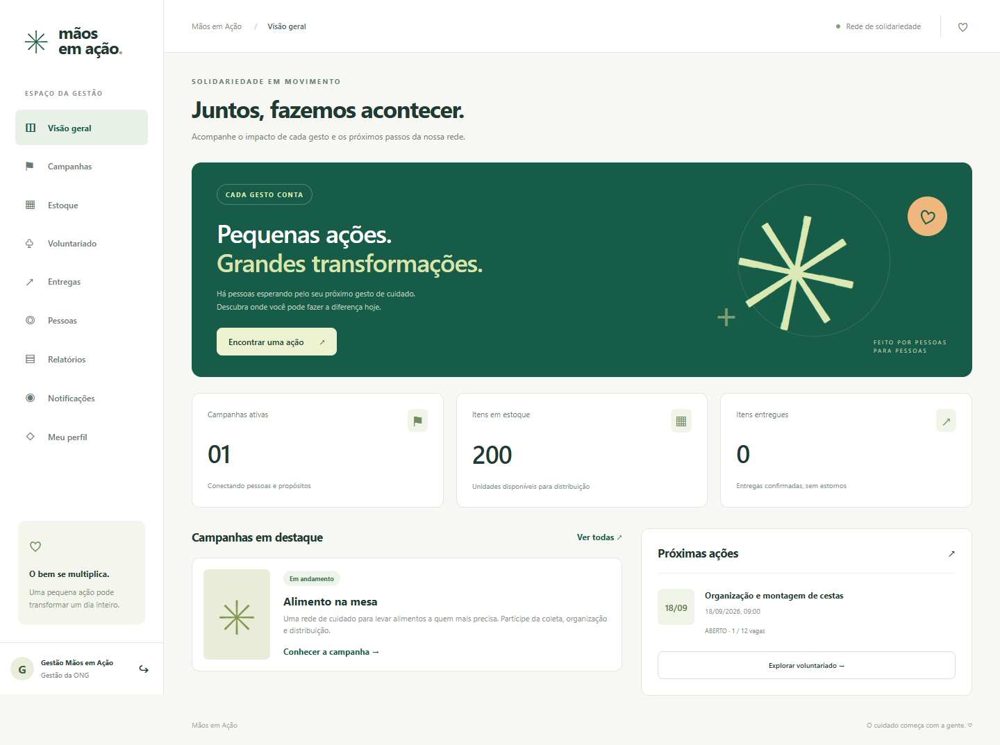

# ✳ Mãos em Ação

Plataforma web para organizar campanhas solidárias, doações, turnos de voluntariado e entregas. Java 21+, Spring Boot, JPA, Angular e banco relacional, com autenticação, testes automatizados e documentação de DDD.

[Repositório público](https://github.com/GuitGud/maos-em-acao) · [Integração contínua](https://github.com/GuitGud/maos-em-acao/actions)



## Comece por aqui

- **[Funcionalidades e comandos de execução/testes](FUNCIONALIDADES_E_TESTES.md)** — guia solicitado, com passo a passo para Windows e Linux.
- [Requisitos e rastreabilidade](docs/REQUISITOS.md).
- [Domínio, linguagem ubíqua e DDD](docs/DOMINIO_E_DDD.md).
- [Mapa de histórias de usuário](docs/MAPA_DE_HISTORIAS.md).
- [Arquitetura, padrões e modelo relacional](docs/ARQUITETURA.md).
- [Modelo Context Mapper](docs/modelo/maos-em-acao.cml).
- [Protótipos de alta fidelidade](docs/prototipos/README.md).
- [Contrato da API](docs/API.md).
- [Declaração e registro do uso de IA](docs/USO_DE_IA.md).
- [Evidências de validação](docs/VALIDACAO.md).

## Executar no Windows

Pré-requisitos: **JDK 21 ou 25**, **Node.js 24**, **pnpm 11.19.0**. Maven é baixado pelo Wrapper.

```powershell
npm install --global pnpm@11.19.0
.\scripts\build.ps1
$env:DEMO_MODE='true'
java -jar target/maos-em-acao-1.0.0.jar
```

Abra **http://localhost:8080**. O build compila o Angular, executa os testes Java e inclui a interface no JAR. A primeira execução requer internet para baixar dependências.

Contas criadas **somente no modo de demonstração, em banco vazio**:

| Perfil | E-mail | Senha de demonstração |
|---|---|---|
| Gestão | `admin@maosemacao.local` | `DemoGestor2026!` |
| Voluntário aprovado | `ana@example.test` | `DemoVoluntario2026!` |

O banco H2 local fica em `data/` e mantém os dados após reiniciar. Para uso sem dados de exemplo, desative `DEMO_MODE` e defina `ADMIN_PASSWORD` antes da primeira execução. Não exponha contas de demonstração à internet.

## Testes

```powershell
.\mvnw.cmd verify
.\mvnw.cmd -f tools/cml-validation/pom.xml test
cd frontend
pnpm test
```

Os testes E2E precisam da aplicação em modo demo e banco isolado em execução. Veja as instruções completas em [FUNCIONALIDADES_E_TESTES.md](FUNCIONALIDADES_E_TESTES.md). O GitHub Actions automatiza backend, Angular, CML e navegador.

## Escopo acadêmico e autoria

Responsável informado: **Guilherme Alcoforado Rabelo (`GuitGud`)**, desenvolvimento individual com assistência de IA declarada. O enunciado exige **4 a 6 integrantes**; a realização individual depende de autorização docente. O projeto não apresenta participantes, commits de terceiros ou contribuições fictícias. A classificação da complexidade também deve ser validada pelo professor.

O sistema atende uma única ONG por instalação. Notificações são uma caixa de entrada dentro da plataforma; não envia e-mail ou SMS. O critério de prioridade calcula uma pontuação por entrega; não executa distribuição automática. Relatórios são retratos salvos do estado atual. Mais detalhes e limites no guia de funcionalidades.
