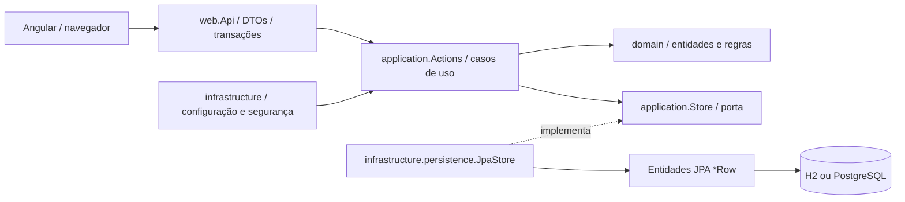
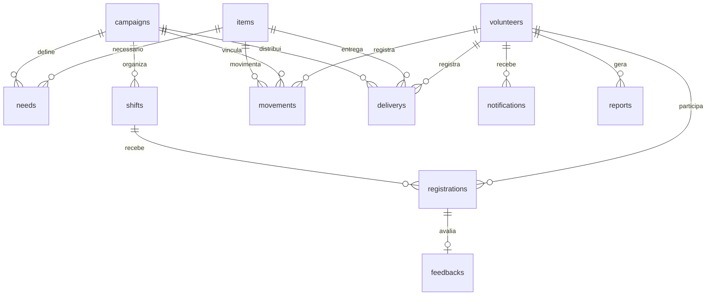

# Arquitetura e padrões

## Arquitetura limpa

`domain` só depende do JDK. `application` depende do domínio e suas próprias portas, sem Spring, HTTP ou JPA. `web` é adaptador de entrada e inicia as transações. `infrastructure` configura os casos de uso e implementa persistência/autenticação. O teste ArchUnit impede que domínio/aplicação dependam de frameworks e que controllers dependam do adaptador JPA concreto.

O projeto é um monólito com contextos lógicos, camada de aplicação compartilhada e um único banco. `Actions` centraliza a orquestração para tornar explícitas as transações entre estoque e distribuição. `Store` é uma porta genérica tipada usada pelos casos de uso; `JpaStore` possui mapeamentos explícitos, sem serializar objetos de negócio em uma coluna JSON. Em uma evolução maior, a porta pode ser subdividida por agregado, com consultas paginadas específicas.

## Padrões exigidos no enunciado

| Padrão | Classes | Uso real | Teste |
|---|---|---|---|
| Strategy | `PriorityStrategy`, `Vulnerability`, `FamilySize` | `Actions.deliver` seleciona regra solicitada na UI e grava pontuação da entrega | `strategiesChangeTheRanking`, entregas na integração |
| Observer | `Events.Observer`, `NotificationObserver` | Mudanças de campanha/turno/aprovação geram mensagens persistentes na transação | `observerBroadcastsToAllSubscribers`, BDD e E2E de aviso |
| Decorator | `VolunteerBadge.Basic`, `.Participation`, `.Dedication` | `Api.person` compõe reconhecimento com base em horas confirmadas | `decoratorsComposeWithoutChangingBase` |
| Iterator | `DeliveryBook` | `Reports.Summary` percorre snapshot de entregas para contar apenas as válidas | `iteratorIsIndependentImmutableAndThrowsAtEnd`, relatórios |
| Proxy | `Reports.AccessProxy` | Verifica papel antes de delegar geração ao relatório real | `proxyDoesNotInvokeTargetForVolunteers`, BDD de acesso |

O Iterator é implementado explicitamente, com estado independente e contrato de fim de iteração. O Proxy não é apenas a regra do Spring Security: ele impede a chamada ao objeto real para atores não gestores. O Decorator envolve objetos do mesmo contrato sem modificar o componente base. Assim, os cinco padrões participam de funcionalidades existentes, e não apenas de exemplos desconectados.

## Consistência e concorrência

Comandos do controller são `@Transactional`; a aplicação não conhece a anotação. Locks pessimistas em campanha, turno, voluntário, item e entrega protegem estados concorrentes. Há também `@Version`, chaves estrangeiras, unicidade e checks no schema.

A ordem habitual é campanha → turno → voluntários por ID, ou campanha → entrega → item. O lock de voluntário coordena inscrição e mudança de agenda. Um cancelamento só bloqueia seu turno; não tenta adquirir campanha depois. A escolha serializa alterações da mesma campanha, adequada ao volume acadêmico, com custo de concorrência reduzida. `ConcurrencyTest` prova que a última vaga não é duplicada e que duas entregas não gastam o mesmo saldo. Também prova rollback de saldo e histórico quando uma exceção ocorre após a mutação.

Estorno pode ocorrer mesmo após encerrar campanha para permitir correção de uma entrega passada. Ele é integral, autorizado apenas ao gestor e irrepetível. A entrega original permanece com `ESTORNADA`; uma nova movimentação positiva restaura o saldo.

## Modelo relacional

O DDL completo está em `src/main/resources/db/migration/V1__initial_schema.sql`. São 11 tabelas de negócio, todas com identidade e versão de persistência. Saldo nunca é recalculado por consultas no navegador: a atualização e sua movimentação são gravadas juntas no servidor.

## Segurança e limites

Sessão Spring Security; senha BCrypt; CSRF em todos os comandos, incluindo login/cadastro/logout; cookies HttpOnly e SameSite=Strict; política CSP; dados do usuário retornados por DTO sem hash. Autorização de negócio usa a pessoa carregada a partir do principal, sem aceitar `actorId` do cliente. Consultas filtram objetos por papel e proprietário. Conteúdo de formulário é interpolado pelo Angular, sem `innerHTML`.

O frontend pode omitir botões por conveniência, mas a regra efetiva está no servidor. O servidor não fornece relatórios, lista de pessoas completa ou dados privados de outra pessoa para voluntários. Não implementa MFA, rate limiting distribuído, recuperação de senha ou proteção contra abuso em escala de produção.

## Decisões e referências

- Angular 20.3.0 e TypeScript 5.9.2, com versões e dependências fixadas no lockfile.
- Spring Boot 3.5.7, Java com target 21, executado localmente em JDK 25. [Compatibilidade oficial do Spring Boot](https://docs.spring.io/spring-boot/3.5/system-requirements.html).
- H2 em arquivo para facilitar avaliação sem serviços externos; PostgreSQL configurado no Compose.
- [Context Mapper: sintaxe de context map](https://contextmapper.org/docs/context-map/) e [sintaxe tática](https://contextmapper.org/docs/tactic-ddd/). O arquivo é validado com a [biblioteca oficial](https://contextmapper.org/docs/library/), versão 6.12.0.
- Notificação síncrona transacional para consistência simples; sem broker/outbox.
- `Clock` injetável para testar limites temporais sem esperar o relógio real.
