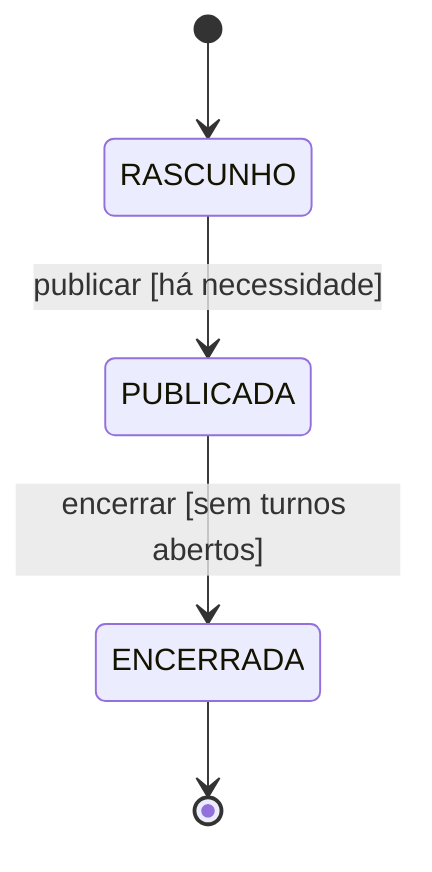
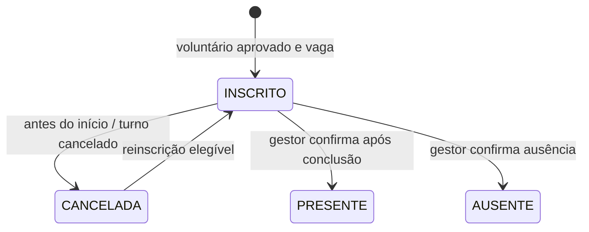

# Domínio, linguagem ubíqua e DDD

## Visão de domínio

Uma ONG recebe doações de itens, articula voluntários em turnos e distribui esses itens a famílias ou instituições. Hoje, informações dispersas dificultam saber o que está faltando, quantas vagas existem e se um item já foi entregue. O Mãos em Ação centraliza esse trabalho, preservando o vínculo entre campanha, movimentação, participação e entrega.

O sistema representa **uma ONG por instalação**. Gestão e voluntários são os atores autenticados. Doadores não são contas: a origem da doação é registrada em texto. Beneficiários são códigos informados nas entregas; não se mantém cadastro pessoal de famílias. O domínio é uma proposta acadêmica, sem alegar entrevistas ou validação com uma ONG real.

## Linguagem ubíqua

| Termo | Significado no projeto | Código / tabela |
|---|---|---|
| Campanha | Ação solidária com propósito, necessidades e ciclo de vida | `Campaign` / `campaigns` |
| Necessidade | Meta de arrecadação de um item em uma campanha | `Need` / `needs` |
| Item | Tipo de bem, unidade e saldo compartilhado da ONG | `Item` / `items` |
| Doação | Entrada positiva de item, com origem e campanha | `Movement`, tipo `DOACAO` |
| Movimentação | Alteração assinada do saldo, com motivo, data e responsável | `Movement` / `movements` |
| Ajuste | Correção justificada de contagem física | `Movement`, tipo `AJUSTE` |
| Voluntário | Pessoa cadastrada; aprovação permite participação | `Volunteer` / `volunteers` |
| Gestor | Pessoa com papel `ADMIN`, responsável por operações administrativas | `Volunteer.role` |
| Turno | Intervalo de atuação vinculado a uma campanha, com capacidade | `Shift` / `shifts` |
| Inscrição | Vínculo único entre voluntário e turno | `Registration` / `registrations` |
| Presença | Confirmação de atuação em turno concluído | `Registration`, estado `PRESENTE` |
| Entrega | Saída de itens para um destinatário identificado por código | `Delivery` / `deliverys` |
| Estorno | Devolução integral de uma entrega ao saldo sem apagar seu registro | `Delivery`, estado `ESTORNADA`; movimento `ESTORNO` |
| Notificação | Mensagem interna de alteração relevante ao participante | `Notification` / `notifications` |
| Avaliação | Nota e comentário vinculados a presença confirmada | `Feedback` / `feedbacks` |
| Relatório | Retrato salvo dos totais em determinado instante | `Report` / `reports` |

O nome físico `deliverys` segue o sufixo técnico usado no mapeamento inicial; não altera o termo de negócio “entrega”. Todos os identificadores entre contextos são IDs, evitando depender de navegação JPA no domínio.

## Nível preliminar: descoberta e limites

Problema: coordenar recursos e pessoas com informação consistente. Objetivo: garantir que uma entrega consuma estoque real e que uma inscrição corresponda a vaga disponível.

Premissas: quantidades inteiras; turnos de no máximo 24 horas; estoque único por item; família/instituição identificada por código; comunicação interna. Não há logística de rotas, pagamentos, múltiplas ONGs ou comprovação documental da vulnerabilidade. A classificação de prioridade é uma regra demonstrativa configurada na entrega.

Eventos levantados na análise: campanha publicada/encerrada, necessidade alterada, doação recebida, estoque ajustado, voluntário aprovado, inscrição realizada/cancelada, turno alterado/concluído/cancelado, presença confirmada, entrega registrada/estornada e avaliação registrada. Nem todo evento conceitual vira mensagem de software: o barramento implementado publica somente as alterações que geram avisos internos.

## Nível estratégico: subdomínios e contextos

| Contexto | Classificação | Responsabilidade e contrato |
|---|---|---|
| Campanhas | Suporte | Define objetivos, necessidades e disponibilidade da campanha |
| Voluntariado | Principal | Agenda, capacidade, elegibilidade e participação real |
| Estoque | Principal | Consistência de saldo e trilha de movimentações |
| Distribuição | Principal | Entregas, estornos e prestação de contas |
| Comunicação | Genérico | Caixa de entrada e confirmação de leitura |

Campanhas fornece a disponibilidade da ação para Voluntariado, Estoque e Distribuição. Voluntariado fornece elegibilidade e horas. Estoque fornece a operação atômica de saldo à Distribuição. Campanhas e Voluntariado publicam mudanças consumidas pela Comunicação.

O [CML](modelo/maos-em-acao.cml) modela essas relações. São **contextos lógicos dentro de um único processo e banco**, não microserviços independentes. O código está organizado por camadas; `Actions` reúne a orquestração dos contextos. Não há alegação de isolamento físico por módulo. Uma evolução possível é extrair serviços de aplicação por contexto sem alterar a direção das dependências.

## Nível tático: modelo e invariantes

- **Campanha** é raiz do agregado que coordena necessidades. Publicação exige ao menos uma meta; encerramento exige ausência de turnos abertos. O lock da campanha protege alterações relacionadas.
- **Item** é raiz de inventário. Seu método `move` impede quantidade nula, saldo negativo e overflow. Movimentações pertencem à trilha imutável desse saldo.
- **Turno** é raiz da agenda e coordena inscrições. A inscrição tem unicidade por pessoa/turno; vagas e datas são verificadas sob lock. O voluntário é bloqueado para serializar inscrições potencialmente sobrepostas.
- **Voluntário** é raiz de identidade e aprovação. Senha hash é detalhe de persistência/autenticação; não é exposta ao cliente.
- **Entrega** preserva destinatário, quantidade, prioridade, autor e instante. Estorno altera seu estado e cria movimento inverso, em uma transação.
- **Relatório, avaliação e notificação** têm identidade própria e regras de acesso específicas.

Entidades de domínio são records Java imutáveis com identidade. Métodos de agregados retornam novos estados, que o adaptador persiste. `LocalDateTime` e quantidades inteiras representam valores; a moeda não faz parte do domínio. `PriorityStrategy` é serviço de domínio; `Store` é porta de repositório; `Events.Change` é evento de aplicação observado pela Comunicação.

Não usamos JPA nos records de domínio. `JpaStore` transforma explicitamente records em entidades `*Row`; essas entidades possuem `@Version` e campos relacionais. Relações por ID são reforçadas com chaves estrangeiras nas migrações.

## Nível operacional: aplicação e execução

Cada comando HTTP passa por autenticação e CSRF, inicia uma transação, obtém o ator pelo principal autenticado, executa o caso de uso, aplica locks quando necessário, grava mudanças e retorna DTO/estado seguro. Falhas de regra são 422, falta de autorização é 403 e concorrência/constraint é 409. Os testes exercitam o mesmo `Actions` da aplicação.

O Observer é síncrono e grava notificações na transação original. Assim, não há aviso de alteração que falhou no commit. Não há broker, consistência eventual ou outbox nesta escala. Os relatórios agregam o estado em uma transação; o snapshot salvo pode ser baixado sem recalcular.

Datas são recebidas em UTC sem sufixo no contrato JSON; o Angular converte do horário local na entrada e de UTC na exibição. `Clock` é injetado para cenários temporais determinísticos. No banco, os timestamps são convencionados como UTC.

## Estados

O cadastro/inscrição é validado no serviço de aplicação porque depende de mais de uma raiz. `Campaign`, `Item` e `Shift` também protegem suas regras locais no domínio. Essa combinação evita colocar decisões de negócio em controllers ou entidades de persistência.
